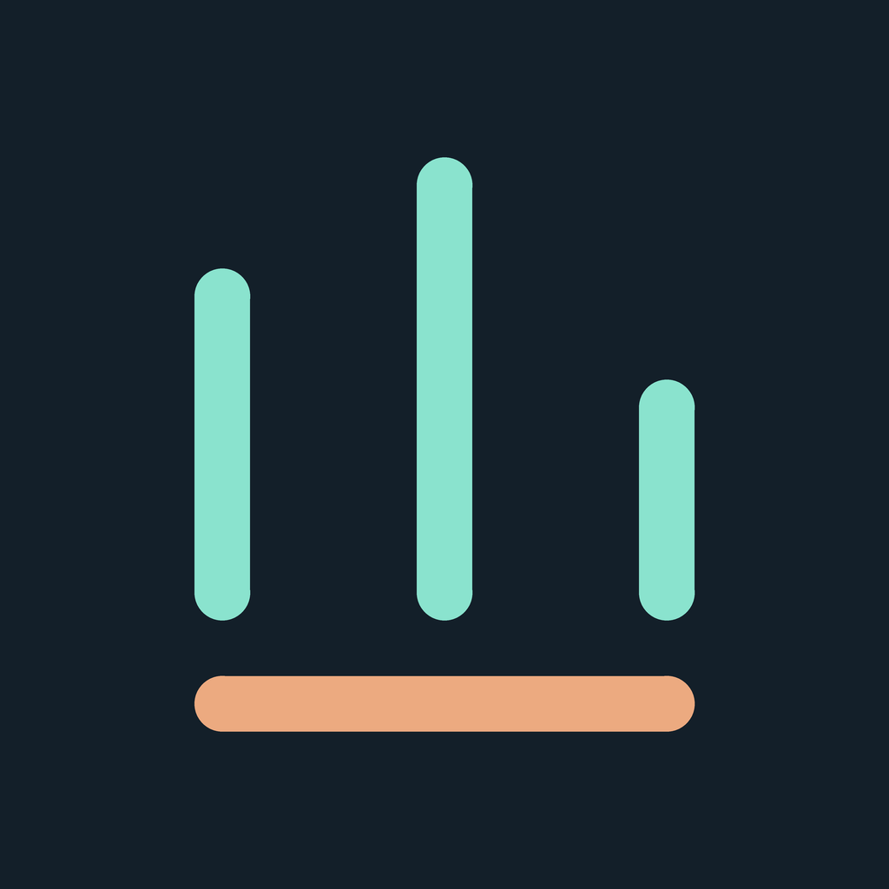

# 額度口袋 · Quota Pocket



一個 Android 桌面小工具，集中查看 Claude、Codex 的剩餘額度與重置倒數，也能設定自己的使用計劃和無聲提醒。

這是「AI·APP」系列的第一個專案，從網上分享的額度小工具獲得靈感，再與 AI 一起製作 Android 版本。目前為個人開發展示 **v0.5.0**，不是 Anthropic 或 OpenAI 的官方產品。

## 功能

- **桌面額度小工具**：Claude、Codex 各一組雙圓環；外圈為 5 小時，內圈為每週，圓心顯示剩得較少的時段。
- **三種使用計劃**：平均分配、按星期分配、保留部分額度稍後使用；每個服務與時段可分別設定。
- **用量提醒**：超用或少用的門檻可自訂，偏離加劇才再次提醒；預設無聲、不震動。
- **重置通知**：資料來源確認新週期後通知，可自行關閉。
- **三個分頁**：總覽看額度、使用計劃排用量、設定管理連線與通知。

## 資料如何更新

| 服務 | 接入方式 | 目前限制 |
| --- | --- | --- |
| Codex | 在手機產生裝置代碼，到官方網頁授權，再由手機讀取額度 | 實驗性相容整合，依賴服務介面，可能失效 |
| Claude | 電腦上的 Claude Code 匯出額度檔案到雲端同步資料夾，手機重新讀取檔案 | 需要電腦產生新資料；狀態列觸發、雲端同步與手機快取都可能造成延遲 |
| 自訂來源 | 使用自己架設的 HTTPS 額度 JSON 服務 | 需自行提供符合格式的服務 |

**目前 Claude 不是手機直接登入，也不是秒級即時同步。** 已觀察到持續使用 Claude Code 時，手機小工具仍可能更新不連續；延遲原因尚在排查。手機重新讀取同一份檔案，不代表取得新額度。

一般背景更新約 15 分鐘；App 顯示中約每分鐘更新，也可主動開啟每分鐘背景模式。省電、網路、來源限制與系統排程可能延後更新。每分鐘模式每次約可持續 6 小時，系統也可能提早停止。請以各服務的資料時間為準。

## 安裝與快速上手

最低支援 **Android 8.0（API 26）**。若取得本專案提供的 APK，下載到手機後開啟安裝；使用同一簽署金鑰的新版可覆蓋安裝，無需先卸載。

1. 到 **設定 → Codex** 完成手機授權；或到 **設定 → Claude → 選擇檔案** 連接雲端額度檔。
2. 在 **總覽** 確認剩餘額度、重置時間與資料時間。
3. 在 **使用計劃** 選擇服務與時段，設定後按 **儲存計劃**。
4. 到 **設定 → 通知設定** 開啟提醒並允許通知；可按 **發送無聲測試通知** 檢查。
5. 到 **總覽 → 桌面小工具 → 加入桌面**，或長按桌面空白處，從小工具清單加入。建議 4 × 2 或 5 × 2 格。

「設定 → 預覽示範資料」會替換目前主資料來源與連線，適合未登入時試看。示範資料不會觸發用量提醒。

### Codex

設定 → Codex → 產生／重新產生代碼 → 複製代碼並開啟官方授權頁 → 完成授權後回 App → 我已完成授權，連接帳號。

這是依 Codex 公開原始碼實作的個人裝置授權相容功能，使用其公開 client ID；不是為 Quota Pocket 註冊的獨立 OAuth 整合，官方授權頁可能顯示 Codex。成功後手機自行讀取額度，無需電腦持續開機。

### Claude

依照 [Claude 檔案連接說明](docs/claude-setup.md)，讓電腦上的 Claude Code 狀態列執行匯出腳本，將額度 JSON 寫到雲端同步資料夾。手機選取同一份檔案後定期重新讀取。

也可使用「設定 → 匯入額度檔案」只讀取一次快照。Claude-only 快照與 Codex 手機連接可並存。

## 使用計劃與提醒

提醒比較資料時間下的「計劃已用」與「實際已用」。計劃 40%、實際 55%，就是超用 **15 個百分點**。

預設超用／少用達 10 個百分點提醒，每再偏離 10 個百分點才再次提醒。兩個方向各自記錄本週期最高提醒級別，回落後再跨過相同級別不重複通知。

示範資料、超過 1 小時的資料、缺少重置時間或來源週期不符時暫停判斷。第一次接入只建立重置基準，不會發出重置通知。詳細規則見 [使用計劃與提醒](docs/usage-alerts.md)。

## 資料與隱私

- 登入憑證加密保存在手機，停用系統備份；不寫入記錄。
- Codex 授權及額度請求只送至程式內固定的官方端點，不轉交自訂服務。
- Claude 匯出工具讀取狀態列提供的資料，不讀取登入憑證、不發送模型請求。
- 雲端硬碟中的額度檔包含方案、剩餘百分比與時間，請自行管理檔案分享權限。
- 此儲存庫不包含個人真實額度快照、登入設定或 APK 簽署金鑰。

## 開發

原生 Java、Android RemoteViews，沒有 App 的第三方執行時依賴。

- JDK 17
- Android SDK Platform 35 / Build Tools 35.0.0
- Android Gradle Plugin 8.9.2；可搭配 Gradle 8.11.1
- 最低 API 26，目標 API 35

Android Studio 請開啟儲存庫根目錄。專案未附 Gradle wrapper；使用已安裝的相容 Gradle，或使用下方 Windows 直接編譯工具：

```powershell
python tools/build_apk.py --java-home "C:/path/to/jdk-17" --android-jar "C:/path/to/Android/Sdk/platforms/android-35/android.jar" --build-tools "C:/path/to/Android/Sdk/build-tools/35.0.0"
```

產物為 output/QuotaPocket-debug.apk。直接編譯工具使用 Windows 的 .exe 工具路徑；第一次執行會在本機建立 .tools/debug.keystore。自行編譯產生的不同簽署金鑰，無法直接覆蓋其他金鑰簽署的安裝版本。

### 測試

```powershell
python -m unittest discover -s tests -v
```

Java 測試位於 tests/*Test.java，使用 org.json:json:20240303 作為獨立 JVM 測試依賴，不會打包進 App。將純 Java 資料／規則類別與對應測試一起編譯後執行。

已有 16 個 Python 測試及 323 個 Java 斷言通過；APK 編譯與 v2／v3 簽章驗證通過。不同手機背景排程及完整授權流程仍需實機驗收，不能以編譯通過代替。

## 文件

- [Claude 檔案連接與延遲排查](docs/claude-setup.md)
- [使用計劃與提醒](docs/usage-alerts.md)
- [額度 JSON 格式](docs/data-source.md)
- [手機同步實作與限制](docs/mobile-sync.md)
- [介面導覽](docs/ui-navigation.md)
- [介紹影片文案](docs/video-script-zh-TW.md)

歡迎透過 Issues 回報問題。請附 App 版本、手機型號、Android 版本、資料時間與重現步驟，不要附登入代碼、token 或私人額度檔。

